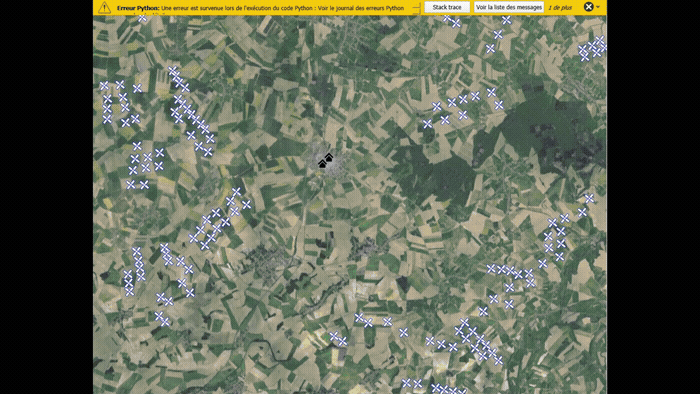

# Saturation Visuelle DREAL Hauts-de-France — Plugin QGIS

Plugin QGIS (Processing) qui automatise le calcul de la **saturation
visuelle éolienne** selon la méthode publiée par la **DREAL Hauts-de-France
(février 2024)** : modélisation géométrique théorique à 360° sur horizon
plat, calcul des indices IOH, ID1, ID2 et IER sur 4 scénarios
réglementaires et 2 rayons d'analyse (0–5 km et 5–10 km).

> ⚠️ Ce plugin implémente une méthodologie **publique et réglementaire**
> (guide DREAL Hauts-de-France, fév. 2024). Il ne contient et ne doit
> contenir aucune donnée de projet réel, aucune donnée client ni aucun
> secret d'affaires — voir [`CONTRIBUTING.md`](CONTRIBUTING.md) pour les
> règles de contribution sur ce point.



## Sommaire

- [Ce que calcule le plugin](#ce-que-calcule-le-plugin)
- [Installation](#installation)
- [Utilisation](#utilisation)
- [Paramètres](#paramètres)
- [Sorties](#sorties)
- [Limites et avertissement](#limites-et-avertissement)
- [Licence](#licence)

## Ce que calcule le plugin

À partir d'un **lieu de vie** (point d'observation) et d'un **inventaire
d'éoliennes** (statuts *Autorisé*, *En service*, *En instruction*, plus
une couche optionnelle de *Projet*), le plugin calcule pour **4 scénarios
réglementaires** :

| Scénario | Composition |
|---|---|
| 1 | En service + Autorisé |
| 2 | Scénario 1 + Projet (couche séparée) |
| 3 | Scénario 1 + En instruction |
| 4 | Scénario 3 + Projet (couche séparée) |

Pour chacun, il produit :

- **IOH** — Indice d'Occupation de l'Horizon (degrés d'horizon occupés)
- **ID1** — Indice de Densité 1
- **ID2** — Indice de Densité 2 (km²)
- **IER** — Indice d'Espace de Respiration (degrés)

avec les seuils d'alerte réglementaires : IOH > 120°, ID1 > 0.1,
ID2 > 0.25 km², IER < 160°.

Le diamètre du rotor peut être fourni :
1. par un champ attributaire propre à chaque éolienne (prioritaire),
2. par une valeur globale unique,
3. à défaut, un repli institutionnel s'applique (120 m pour une éolienne
   isolée, ou distance centre-à-centre en configuration multi-mâts).

## Installation

### Depuis le fichier .zip (recommandé)

1. Télécharge la dernière release (`Releases` → dernier tag) ou clone ce
   dépôt et compresse le dossier `saturation_dreal/`.
2. Dans QGIS : `Extensions` → `Installer/gérer les extensions` →
   `Installer depuis un ZIP`.
3. Sélectionne le fichier `.zip` et active le plugin.

### Depuis les sources (développement)

```bash
git clone https://github.com/<ton-user>/saturation-dreal-qgis.git
# Copier ou lier le dossier saturation_dreal/ vers le profil QGIS :
# Linux :   ~/.local/share/QGIS/QGIS3/profiles/default/python/plugins/
# Windows : %APPDATA%\QGIS\QGIS3\profiles\default\python\plugins\
# macOS :   ~/Library/Application Support/QGIS/QGIS3/profiles/default/python/plugins/
```

**Prérequis** : QGIS ≥ 3.16, `matplotlib` et `numpy` disponibles dans
l'environnement Python de QGIS (voir [`requirements.txt`](requirements.txt))
pour la génération des figures.

## Utilisation

1. Ouvre la **Boîte à outils de traitements** (`Ctrl+Alt+T`).
2. Cherche **"Saturation Visuelle DREAL HdF"**.
3. Renseigne le lieu de vie, l'inventaire d'éoliennes et les champs
   requis (statut, nom du parc).
4. Lance l'algorithme : le plugin génère automatiquement les couches,
   les figures polaires et le rapport CSV dans le dossier choisi.

## Paramètres

| Paramètre | Description | Optionnel |
|---|---|---|
| Lieu de vie | Point d'observation unique | Non |
| Inventaire éoliennes | Couche point, statuts réglementaires | Non |
| Champ : Statut réglementaire | Champ texte de l'inventaire | Non |
| Champ : Nom du parc | Champ texte de l'inventaire | Non |
| Diamètre du rotor global (m) | Valeur unique appliquée à toutes les éoliennes | Oui |
| Champ : Diamètre du rotor | Champ numérique, prioritaire sur la valeur globale | Oui |
| Éoliennes du projet propre | Couche séparée pour les scénarios 2 et 4 | Oui |
| Champ : Nom du parc (projet propre) | — | Oui |
| Nom du projet | Utilisé dans les titres et noms de fichiers | Non |
| Dossier de sortie | Structure créée automatiquement | Non |

## Sorties

- **Rapport texte** des indices DREAL pour les 4 scénarios.
- **CSV matriciel** (4 lignes × 15 colonnes), compatible Excel Europe
  (séparateur `;`, encodage `utf-8-sig`, décimales à virgule).
- **Figures polaires PNG** (`<nom_projet>_polaire_Sc<N>.png`) conformes
  §3.4 de la méthodologie DREAL.
- **Tableau de synthèse PNG** (`<nom_projet>_synthese.png`),
  4 scénarios × 6 indices.
- **Couche d'anneaux** 0–5 km / 5–10 km, stylée automatiquement.
- **Couche des secteurs** (wedges) avec symbologie catégorisée par
  scénario/statut.

## Limites et avertissement

- Modélisation **géométrique théorique sur horizon plat** : elle ne
  prend pas en compte le relief, la végétation ni le bâti — conforme en
  cela à la méthode DREAL, mais à interpréter comme un indicateur
  d'alerte réglementaire, pas comme une simulation visuelle réaliste.
- Les seuils et la formulation des indices suivent le guide DREAL
  Hauts-de-France de février 2024 ; toute évolution de la doctrine
  administrative peut nécessiter une mise à jour du plugin.
- Ce plugin est fourni **sans garantie** (voir la licence) : il reste de
  la responsabilité de l'utilisateur de vérifier la conformité des
  résultats avant tout usage réglementaire ou contractuel.

## Licence

Distribué sous licence **GPL v2 ou ultérieure** — voir [`LICENSE`](LICENSE).
Choix cohérent avec la licence de QGIS lui-même et avec les exigences du
dépôt officiel des extensions QGIS.

## Auteur

William Martinez — géomaticien / développeur PyQGIS.
Contact : williammartinezruiz@gmail.com
